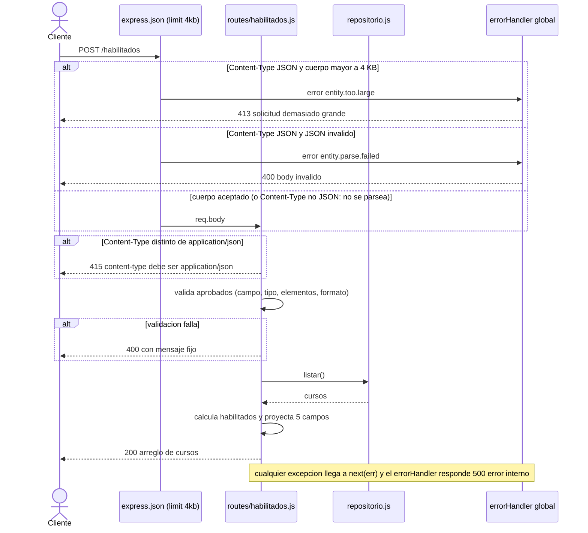
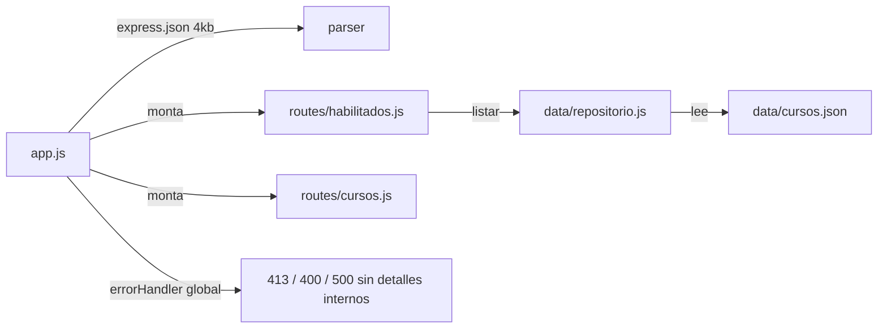

# Documento de Diseño: POST /habilitados

## Overview

`POST /habilitados` recibe los códigos de los cursos que un alumno ya aprobó y devuelve los cursos del catálogo que puede llevar a continuación. Un curso está **habilitado** cuando (a) todos sus prerequisitos están en `aprobados` (un curso sin prerequisitos cumple siempre esta condición) y (b) el propio curso no está en `aprobados`.

Los datos se leen con `repositorio.listar()`, que carga `data/cursos.json` una sola vez al arrancar. El endpoint no escribe ni altera estado.

El diseño responde a tres hallazgos de seguridad del prototipo anterior:

| Hallazgo | Causa | Respuesta del diseño |
| --- | --- | --- |
| 1. 5 000 códigos dejaron el servicio sin responder 40 s | No había límite de tamaño | Límite de 4 KB en `express.json` → 413 (Requisito 3) |
| 2. `1INF30<script>` provocó un 500 con stack trace y ruta | No se validaba el formato del código y el manejador de errores devolvía el stack | Validación `^[A-Z0-9]{6}$` → 400 sin reflejar el valor (Req. 2.6); 500 genérico sin detalles internos (Req. 4) |
| 3. `{"aprobados": "1INF25"}` respondió 200 con resultados incorrectos | No se validaba el tipo | Validación de tipo del campo y de sus elementos → 400 (Req. 2.3 a 2.5) |

### Diagrama de secuencia



---

## Architecture

### Archivos nuevos

| Archivo | Responsabilidad |
| --- | --- |
| `src/routes/habilitados.js` | Validación de la entrada y cálculo de los cursos habilitados. |
| `tests/habilitados.test.js` | Tests con supertest sobre `src/app.js` para cada criterio de aceptación. |

### Archivos modificados

| Archivo | Cambio |
| --- | --- |
| `src/app.js` | Cambiar `express.json()` por `express.json({ limit: '4kb' })` y montar el router en `/habilitados`. No se agrega ningún middleware `bodyLimit` aparte. |
| Middleware de errores global (`src/app.js`, tarea 3 de `consulta-cursos`) | Traducir `err.type`: `entity.too.large` → 413, `entity.parse.failed` → 400, cualquier otro error → 500 genérico. |
| `jest.config.js` | Agregar `coverageThreshold` global de 80 % en líneas. |
| `package.json` / `package-lock.json` | Subir `lodash` de `4.17.20` a `4.18.1`, la versión que propone `npm audit` para corregir la vulnerabilidad alta. |
| `config/ejemplo.env` | Reemplazar `CATALOGO_API_KEY` por un valor de ejemplo y registrar el fingerprint del hallazgo histórico en `.gitleaksignore` con su razón. |
| `.github/workflows/ci.yml` | Agregar los jobs de SCA y de detección de secretos, pasar `--coverage` a `npm test` y agregar un disparador semanal programado. |

### Archivos sin cambios

`src/data/repositorio.js`, `src/server.js`, `data/cursos.json`.

### Diagrama de componentes



---

## Components and Interfaces

### `src/routes/habilitados.js`

```
Router de Express con un único handler: POST /

Dependencias:
  require('../data/repositorio') → { listar }

Funciones internas:
  validarAprobados(body) → { ok: true, aprobados } | { ok: false, status, error }
    Aplica las validaciones 4 a 7 de la tabla de validaciones, en orden.

  calcularHabilitados(aprobadosSet, todos) → Curso_Habilitado[]
    Devuelve los cursos habilitados proyectados a { id, name, credits, cycle, type }.
```

### Contrato HTTP

```
POST /habilitados
Content-Type: application/json
Cuerpo:  { "aprobados": string[] }

200  [ { "id": string, "name": string, "credits": number, "cycle": number|null, "type": string }, ... ]
400  { "error": string }
413  { "error": "solicitud demasiado grande" }
415  { "error": "content-type debe ser application/json" }
500  { "error": "error interno" }
```

---

## Data Models

### Curso (catálogo, `data/cursos.json`)

```
{ id, name, credits, cycle: number|null, type: "obligatorio"|"electivo", prerequisites: string[] }
```

### Curso_Habilitado (respuesta)

```
{ id, name, credits, cycle, type }
```

Se proyectan solo estos cinco campos, igual que `GET /cursos`. El campo `prerequisites` no se incluye.

### Algoritmo

```
calcularHabilitados(aprobados):
  aprobadosSet ← new Set(aprobados)            // deduplica
  habilitados ← []
  para cada curso en repositorio.listar():
    si curso.id está en aprobadosSet → continuar              // ya aprobado
    si algún prerequisito NO está en aprobadosSet → continuar // falta un requisito
    habilitados.push(curso proyectado a 5 campos)
  devolver habilitados
```

`[].every()` devuelve `true`, por lo que un curso sin prerequisitos pasa el filtro sin caso especial.

### Validaciones y orden de ejecución

Se aplican en este orden. El primer fallo detiene el procesamiento y devuelve ese error.

| # | Capa | Condición | HTTP | Cuerpo | Requisito |
| --- | --- | --- | --- | --- | --- |
| 1 | `express.json` | Content-Type JSON y cuerpo mayor a 4 KB | 413 | `{"error":"solicitud demasiado grande"}` | 3.1 |
| 2 | `express.json` | Content-Type JSON y cuerpo que no es JSON válido | 400 | `{"error":"body inválido"}` | 2.1 |
| 3 | Ruta | `Content-Type` ausente o distinto de `application/json` (`!req.is('application/json')`) | 415 | `{"error":"content-type debe ser application/json"}` | 2.2 |
| 4 | Ruta | Campo `aprobados` ausente | 400 | `{"error":"aprobados es requerido"}` | 2.3 |
| 5 | Ruta | `aprobados` no es un arreglo (incluye `null`) | 400 | `{"error":"aprobados debe ser un arreglo"}` | 2.4 |
| 6 | Ruta | Algún elemento no es una cadena | 400 | `{"error":"aprobados debe contener solo cadenas"}` | 2.5 |
| 7 | Ruta | Algún elemento no cumple `^[A-Z0-9]{6}$` | 400 | `{"error":"aprobados contiene códigos con formato inválido"}` | 2.6 |

Notas:

- `express.json` solo lee el cuerpo cuando el `Content-Type` es JSON; con otro tipo lo deja pasar con `req.body = {}`. Por eso el 415 se comprueba en la ruta y no lo genera el parser.
- Con `strict: true` (valor por defecto), el parser rechaza como JSON inválido los cuerpos que no son objeto ni arreglo (por ejemplo `"x"`, `5` o `null`). Un arreglo en la raíz llega a la ruta y se responde "aprobados es requerido".
- Ningún mensaje de error incluye el valor recibido ni el texto de la excepción original.

---

## Error Handling

- `express.json({ limit: '4kb' })` en `src/app.js` reemplaza al `express.json()` actual.
- El `errorHandler` global traduce según `err.type`:
  - `entity.too.large` → 413 `{"error":"solicitud demasiado grande"}`
  - `entity.parse.failed` → 400 `{"error":"body inválido"}`
  - cualquier otro error → 500 `{"error":"error interno"}`
- La respuesta 500 nunca incluye `err.message`, `err.stack` ni rutas. El detalle completo solo se escribe en el log del servidor con `console.error`.
- Si `res.headersSent` es verdadero, el manejador delega con `next(err)`.

---

## Testing Strategy

Tests con Jest y supertest sobre `src/app.js` (sin levantar el servidor), en `tests/habilitados.test.js`. Cada criterio de aceptación tiene al menos un test. Para comparar la respuesta se usa el conjunto de `id`, no el orden.

| ID | Descripción | Requisito |
| --- | --- | --- |
| T1.1 | `aprobados: []` devuelve 200 con exactamente los cursos del catálogo cuyo `prerequisites` está vacío | 1.1, 1.2 |
| T1.2 | Cada elemento de la respuesta tiene solo los campos `id`, `name`, `credits`, `cycle` y `type` | 1.1 |
| T1.3 | Un curso con prerequisitos es incluido cuando todos están en `aprobados` (por ejemplo `1INF30` con `["1INF25"]`) y excluido cuando falta alguno | 1.3 |
| T1.4 | Un código que está en `aprobados` no aparece en la respuesta aunque sus prerequisitos estén cumplidos | 1.4 |
| T1.5 | `["1INF25","1INF27","1INF49"]` devuelve exactamente 27 cursos, incluidos `1INF29`, `1INF30`, `1INF31` y `1INF32` | 1.5 |
| T1.6 | Para varios conjuntos fijos de aprobados (vacío, todo el ciclo 5, todos los cursos), la respuesta coincide con un cálculo independiente hecho en el test; con todos aprobados la respuesta es `[]` | 1.1 a 1.4 |
| T1.7 | Duplicados y códigos bien formados que no existen en el catálogo (por ejemplo `"ZZZ999"`) no cambian el resultado ni producen error | Decisiones |
| T2.1 | Cuerpo `{"aprobados":` (JSON roto) con Content-Type JSON → 400 `body inválido` | 2.1 |
| T2.2 | `Content-Type: text/plain` → 415 | 2.2 |
| T2.3 | `{"otro": []}` → 400 `aprobados es requerido` | 2.3 |
| T2.4 | `{"aprobados": "1INF25"}` → 400 `aprobados debe ser un arreglo` (hallazgo 3); también `null` y un objeto | 2.4 |
| T2.5 | `{"aprobados": [123]}` → 400 `aprobados debe contener solo cadenas`; también `null`, booleano y objeto | 2.5 |
| T2.6 | `{"aprobados": ["minusc"]}` y `["1INF2"]` → 400 formato inválido | 2.6 |
| T2.7 | `{"aprobados": ["1INF30<script>"]}` → 400 formato inválido y el cuerpo de la respuesta no contiene `script` ni `<` (hallazgo 2) | 2.6 |
| T3.1 | Cuerpo de 4 097 bytes → 413 `solicitud demasiado grande` en 1 s o menos | 3.1 |
| T3.2 | `aprobados` con 5 000 códigos → 413 en 1 s o menos (hallazgo 1) | 3.1 |
| T3.3 | Cuerpo válido de menos de 4 KB (por ejemplo 100 códigos) → 200 | 3.1 |
| T4.1 | `jest.spyOn(repositorio, 'listar')` lanzando un error → 500 `{"error":"error interno"}` | 4.1 |
| T4.2 | El error simulado en T4.1 usa el mensaje `C:\apps\malla\src\data\repositorio.js` y un stack; el cuerpo de la respuesta no contiene `stack`, ` at `, `.js` ni `C:\` | 4.2 |
| T4.3 | JSON roto (T2.1) y cuerpo grande (T3.1) no producen 500 | 4.1 |

El Requisito 5.1 (cobertura) no se verifica con un test sino con el gate de cobertura de CI (ver más abajo).

---

## Quality y security gates (CI)

Cada requisito no funcional queda verificado por un gate o por tests, y la evidencia se registra en `TRAZABILIDAD.md`.

| Gate | Herramienta | Umbral | Bloquea / avisa | Etapa | Razón |
| --- | --- | --- | --- | --- | --- |
| Cobertura (Req. 5.1) | `jest --coverage` con `coverageThreshold` global en `jest.config.js` | 80 % de líneas en `src/` (excluye `src/server.js`) | Bloquea | Pull request y main | Lo exige la política de TI. Corre en el PR para dar feedback antes del merge y en main para detectar regresiones. Un umbral por archivo no se usa porque el gate de Jest mide el global y no distingue archivos nuevos |
| SCA | `npm audit --audit-level=high`, incluye devDependencies | 0 vulnerabilidades high o critical | Bloquea. Las moderate y low solo se reportan, sin fallar | Pull request, main y cron semanal | La política de TI prohíbe high y critical. En el PR frena el merge. El cron semanal detecta CVE nuevos que aparecen sin que cambie el código. Las devDependencies se incluyen porque Jest y supertest se ejecutan en el runner de CI |
| Detección de secretos | gitleaks con versión fija, escaneo del historial completo (`gitleaks git`, checkout con `fetch-depth: 0`) | Cualquier hallazgo | Bloquea | Pull request y main | Un secreto borrado en un commit posterior sigue expuesto en el historial, y una sola coincidencia obliga a rotar la clave, por eso no hay umbral. Se evita `gitleaks-action` porque por defecto solo escanea los commits del push o del PR, y un secreto ya presente en `main` no se vería |
| SAST (extra, opcional) | CodeQL para JavaScript | Alertas de severidad alta | Avisa (reporta en el PR y en la pestaña Security) | Pull request, main y cron semanal | Detecta patrones inseguros en el código propio (inyección, XSS). Avisa y no bloquea porque puede dar falsos positivos que requieren triage antes de decidir bloquear |

### Decisiones sobre los gates

- **Fingerprint histórico.** La clave `CATALOGO_API_KEY` está en el commit `7506fec`. Aun reemplazada en el archivo, el escaneo del historial completo seguirá detectándola. La corrección es: rotar la clave, reemplazar el valor en `config/ejemplo.env` por un placeholder y registrar el fingerprint en `.gitleaksignore` con un comentario que indique la razón (clave de ejemplo ya rotada).
- **`lodash`.** Se sube a `4.18.1`. Solo la usa `src/util/formato.js`, que la aplicación no importa.
- **`src/util/formato.js`.** Se mide la cobertura después de implementar. Si baja del 80 %, se agrega `tests/formato.test.js` (funciones puras, sin lógica nueva) en lugar de excluir el archivo de la cobertura, porque excluirlo ocultaría código sin probar.
- **Disparadores de `ci.yml`.** `push` a `main`, `pull_request` a `main` y `schedule` semanal. El cron solo ejecuta el job de SCA.

---

## Decisiones sobre casos no cubiertos por el pedido

| Caso | Decisión | Justificación |
| --- | --- | --- |
| Códigos duplicados en `aprobados` | Se ignoran (se tratan como conjunto) | No cambian el resultado; rechazarlos penaliza al alumno por un error inocuo. El tamaño máximo lo acota el límite de 4 KB |
| Código con formato válido que no está en el catálogo | Se ignora | El alumno puede haber aprobado cursos de Estudios Generales (ciclos 1 a 4), que están fuera del alcance de `product.md`. Esos códigos no afectan ningún requisito del catálogo |
| `aprobados: []` | 200 con los cursos sin prerequisitos | Es lo que dicta el pedido: un curso sin requisitos está habilitado |
| Código en minúsculas (`1inf25`) | 400 por formato, sin normalizar | Mantiene el patrón del Requisito 2.6 estricto y la entrada predecible |
| Campos extra en el body | Se ignoran | Solo importa `aprobados` |
| Forma de cada curso en la respuesta | `id`, `name`, `credits`, `cycle`, `type`, sin `prerequisites` | Es la misma que `GET /cursos` |
| Orden de la respuesta | El orden de `repositorio.listar()`: ciclo ascendente y electivos (`cycle: null`) al final | Es determinista y no requiere ordenar |
| Electivos (`cycle: null`) | Se incluyen si cumplen la condición | Forman parte del catálogo |
| Límite de elementos de `aprobados` | No hay un límite propio; lo acota el límite de 4 KB | Con códigos de al menos 5 caracteres caben unos 500 elementos como máximo, y recorrer 87 cursos contra ese conjunto es acotado. Un segundo límite no estaría en los requisitos |
| Cuerpo que no es objeto ni arreglo (`"x"`, `5`, `null`) | 400 `body inválido` | El parser con `strict: true` lo rechaza como JSON inválido |

## Consideraciones de seguridad y rendimiento

- **Sin reflexión de entrada.** Ningún mensaje de error incluye el valor recibido: evita XSS reflejado en clientes que rendericen el JSON sin escapar, y evita que el error sirva como oráculo para probar patrones.
- **Entrada acotada.** El límite de 4 KB se aplica antes de parsear el JSON, así que una carga grande no consume CPU ni memoria.
- **Errores opacos.** El cliente nunca recibe stack traces ni rutas; el detalle solo se registra en el servidor.
- **Complejidad.** El cálculo es O(C × P), con C = 87 cursos y P = prerequisitos por curso, sobre un `Set` con búsqueda O(1).

## Dependencias

No se agregan dependencias nuevas. Los gates usan `npm audit` (incluido en npm), un binario de gitleaks con versión fija y, si se hace el extra, la acción oficial de CodeQL de GitHub. Se usa el `supertest` y el `jest` que ya existen.