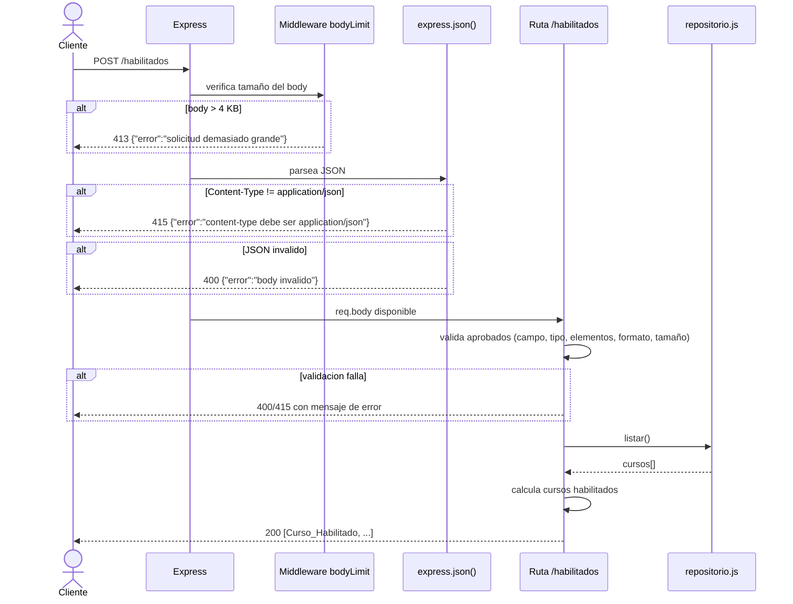

# Documento de Diseño: POST /habilitados

## Overview

El endpoint `POST /habilitados` recibe la lista de códigos de cursos que un alumno ya aprobó y devuelve todos los cursos del catálogo que ese alumno puede matricular a continuación. Un curso es **habilitado** cuando (a) ninguno de sus prerequisitos está pendiente y (b) el alumno todavía no lo ha aprobado. Los cursos sin prerequisitos siempre cumplen la condición (a).

Todos los datos del catálogo se obtienen de `repositorio.js` a través de `listar()`, que lee `data/cursos.json` una sola vez al arrancar. El endpoint no escribe ni altera estado.

### Diagrama de secuencia



---

## Architecture

### Archivos nuevos

| Archivo | Responsabilidad |
|---------|-----------------|
| `src/routes/habilitados.js` | Lógica de validación y cálculo del endpoint `POST /habilitados`. |

### Archivos modificados

| Archivo | Cambio |
|---------|--------|
| `src/app.js` | Registrar el middleware `bodyLimit` antes de `express.json()` y montar `require('./routes/habilitados')` en `/habilitados`. |
| `jest.config.js` | Agregar `coverageThreshold` para forzar ≥ 80 % de líneas en CI. |
| `.github/workflows/ci.yml` | Agregar los pasos de `npm audit` y `gitleaks`, y pasar `--coverage` a `npm test`. |

### Archivos sin cambios

`src/data/repositorio.js`, `src/routes/cursos.js`, `src/util/formato.js`, `src/server.js`, `data/cursos.json`.

### Diagrama de componentes

```mermaid
graph LR
    A[app.js] -->|monta| B[routes/habilitados.js]
    A -->|monta| C[routes/cursos.js]
    B -->|listar()| D[data/repositorio.js]
    D -->|lee| E[data/cursos.json]
    A -->|errorHandler global| F[500 sin stack trace]
```

---

## Components and Interfaces

### `src/routes/habilitados.js`

```
Router de Express con un único handler: POST /

Interfaz pública:
  module.exports → Express Router

Dependencias:
  require('../data/repositorio') → { listar }

Funciones internas:
  validarAprobados(aprobados) → { ok: boolean, status: number, error: string }
    Aplica las validaciones en orden (tabla de Validaciones).
    Devuelve { ok: true } si todos los checks pasan.

  calcularHabilitados(aprobadosSet, todos) → Curso[]
    Recibe el Set deduplicado y la lista completa de cursos.
    Devuelve los cursos habilitados proyectados a { id, name, credits, cycle, type }.
```

### `src/app.js` — cambios

```
Antes de express.json():
  app.use(bodyLimitMiddleware)   ← responde 413 si body > 4 096 bytes

Después de los routers existentes:
  app.use('/habilitados', require('./routes/habilitados'))
```

### Contrato HTTP del endpoint

```
POST /habilitados
Content-Type: application/json

Body de entrada:
  { "aprobados": string[] }

Respuesta 200:
  [
    { "id": string, "name": string, "credits": number, "cycle": number|null, "type": string },
    ...
  ]

Respuestas de error:
  400 { "error": string }   — validación fallida
  413 { "error": "solicitud demasiado grande" }
  415 { "error": "content-type debe ser application/json" }
  500 { "error": "error interno" }  — manejado por errorHandler global
```

---

## Data Models

### Curso (del catálogo — `data/cursos.json`)

```
{
  id:            string        — código único, ej. "1INF25"
  name:          string        — nombre del curso
  credits:       number        — créditos académicos
  cycle:         number | null — ciclo (5–10) o null para electivos
  type:          string        — "obligatorio" | "electivo"
  prerequisites: string[]      — códigos de cursos prerequisito
}
```

### Curso_Habilitado (respuesta de `POST /habilitados`)

```
{
  id:      string
  name:    string
  credits: number
  cycle:   number | null
  type:    string
}
```

Solo se proyectan los cinco campos del contrato. El campo `prerequisites` del catálogo no se incluye en la respuesta.

### Algoritmo de cálculo

El cálculo es una operación pura sobre los datos del catálogo.

```
función calcularHabilitados(aprobados: string[]) → Curso_Habilitado[]

  // 1. Deduplicar (silenciosamente) y convertir a Set para lookups O(1)
  aprobadosSet ← new Set(aprobados)

  // 2. Verificar límite de tamaño (aplica al Set deduplicado)
  si aprobadosSet.size > 500:
    devolver error 400 "aprobados excede el límite permitido"

  // 3. Obtener todos los cursos del catálogo
  todos ← repositorio.listar()

  // 4. Filtrar
  habilitados ← []
  para cada curso en todos:
    si curso.id está en aprobadosSet → continuar   // ya aprobado → excluir
    si curso.prerequisites.length > 0:
      si algún prereq NO está en aprobadosSet → continuar  // falta prereq → excluir
    habilitados.append(curso)

  // 5. Proyectar solo los campos del contrato
  devolver habilitados.map(c → { id, name, credits, cycle, type })
```

La complejidad es **O(C × P)** donde C = 87 cursos y P = máximo de prerequisitos por curso. Con los datos actuales es prácticamente lineal en C.

### Validaciones y orden de ejecución

Las validaciones se ejecutan en orden estricto. El primer fallo detiene el procesamiento.

| # | Capa | Condición | HTTP | Cuerpo de respuesta |
|---|------|-----------|------|---------------------|
| 1 | Middleware `bodyLimit` | Cuerpo > 4 096 bytes | 413 | `{"error":"solicitud demasiado grande"}` |
| 2 | `express.json()` | `Content-Type` ≠ `application/json` | 415 | `{"error":"content-type debe ser application/json"}` |
| 3 | `express.json()` | Cuerpo no es JSON válido | 400 | `{"error":"body inválido"}` |
| 4 | Ruta | Campo `aprobados` ausente | 400 | `{"error":"aprobados es requerido"}` |
| 5 | Ruta | `aprobados` no es arreglo | 400 | `{"error":"aprobados debe ser un arreglo"}` |
| 6 | Ruta | Algún elemento no es string | 400 | `{"error":"aprobados debe contener solo cadenas"}` |
| 7 | Ruta | Algún elemento no cumple `^[A-Z0-9]{5,6}$` | 400 | `{"error":"aprobados contiene códigos con formato inválido"}` |
| 8 | Ruta | Set deduplicado > 500 elementos | 400 | `{"error":"aprobados excede el límite permitido"}` |

**Notas:**

- El middleware `bodyLimit` se implementa con `express.json({ limit: '4kb' })` más un manejador de error intermedio que convierte el error de Express a 413 con el cuerpo exacto.
- La validación de formato (fila 7) **no incluye el valor recibido** en el mensaje (Requisito 2.6 y defensa contra reflexión de entrada).
- El límite de 500 (fila 8) se aplica **después** de deduplicar con `Set`.

### Decisiones sobre casos no cubiertos explícitamente

| Caso | Decisión | Justificación |
|------|----------|---------------|
| Duplicados en `aprobados` | Se deduplicar silenciosamente con `Set` antes de la validación de longitud. | Duplicados no cambian el resultado; contarlos penalizaría al alumno que repitió un código por error. |
| Códigos no existentes en el catálogo | Se ignoran. | El endpoint responde qué se puede matricular, no valida el historial académico. Códigos desconocidos no habilitan ni deshabilitan ningún curso real. |
| Lista vacía `[]` | Es válida; devuelve los cursos sin prerequisitos. | Caso base correcto: sin aprobar nada, solo los cursos de entrada están disponibles. |
| Orden de la respuesta | Se devuelve en el orden de `listar()` (ciclo ascendente, estable). | El catálogo ya está ordenado por ciclo; no requiere ordenamiento adicional. |
| `aprobados: null` | Tratado como "no es arreglo" → 400 `"aprobados debe ser un arreglo"`. | `Array.isArray(null) === false`; coherente con la validación de tipo. |

---

## Correctness Properties

*Una propiedad es una característica o comportamiento que debe mantenerse verdadero en todas las ejecuciones válidas del sistema — esencialmente, un enunciado formal sobre lo que el sistema debe hacer. Las propiedades sirven como puente entre las especificaciones legibles por humanos y las garantías de corrección verificables por máquina.*

Se usa **fast-check** (agregado como `devDependency`) para los property tests. Es la biblioteca de PBT más usada en el ecosistema JavaScript/Jest, con generadores que producen subconjuntos aleatorios de IDs del catálogo, strings con formatos arbitrarios y arreglos mixtos — exactamente los tipos de entrada que ejercen los invariantes de este endpoint. No va a producción.

### Property 1: Corrección de inclusión de cursos habilitados

*Para cualquier* subconjunto válido de códigos de cursos aprobados, todo curso del catálogo cuyo `id` no esté en `aprobados` y cuyos todos los códigos de prerequisito sí estén en `aprobados` (incluyendo el caso vacío de prerequisitos) DEBE aparecer en el arreglo de respuesta.

**Validates: Requirements 1.1, 1.2, 1.3**

### Property 2: Exclusión de cursos ya aprobados

*Para cualquier* subconjunto válido de códigos de cursos aprobados, ningún curso cuyo `id` aparezca en `aprobados` DEBE estar presente en el arreglo de respuesta.

**Validates: Requirements 1.4**

### Property 3: Rechazo de elementos no-string con mensaje exacto

*Para cualquier* arreglo `aprobados` que contenga al menos un elemento que no sea una cadena de texto (número, booleano, `null`, objeto), el endpoint DEBE responder 400 con `{"error":"aprobados debe contener solo cadenas"}`.

**Validates: Requirements 2.5**

### Property 4: Rechazo de códigos con formato inválido sin reflejar el valor recibido

*Para cualquier* arreglo `aprobados` que contenga al menos un elemento que no cumpla el patrón `^[A-Z0-9]{5,6}$`, el endpoint DEBE responder 400 con `{"error":"aprobados contiene códigos con formato inválido"}` y el cuerpo de la respuesta NO DEBE contener el valor del elemento inválido.

**Validates: Requirements 2.6**

### Property 5: Respuestas 500 sin información interna

*Para cualquier* error no controlado lanzado durante el procesamiento de `POST /habilitados` (con cualquier mensaje, ruta de archivo o traza de pila), la respuesta DEBE ser 500 con `{"error":"error interno"}` y el cuerpo NO DEBE contener las cadenas `"stack"`, `" at "`, `".js"` ni patrones de ruta de archivo.

**Validates: Requirements 4.1, 4.2**

---

## Error Handling

### Errores de validación (400 / 413 / 415)

Todos los errores de validación se generan dentro de `src/routes/habilitados.js` antes de llamar a `repositorio.js`. Se devuelven con `res.status(N).json({ error: '...' })` usando los mensajes exactos del Requisito 2.

### Error de tamaño de body (413)

El middleware `bodyLimit` captura el error que lanza `express.json` cuando el cuerpo supera el límite configurado. Se identifica por `err.type === 'entity.too.large'` o `err.status === 413` y se responde con el cuerpo `{"error":"solicitud demasiado grande"}` antes de que el error llegue al `errorHandler` global.

### Content-Type incorrecto (415)

Cuando `express.json()` recibe una solicitud sin `Content-Type: application/json`, lanza un error con `err.status === 415` o `err.type === 'entity.parse.failed'`. Se intercepta con un manejador de error intermedio inmediatamente después del middleware `express.json({ type: ... })` configurado para solo parsear `application/json`. Si el Content-Type no coincide, se responde 415 con `{"error":"content-type debe ser application/json"}`.

### Errores no controlados (500)

Cualquier excepción no capturada en la ruta se propaga a través de `next(err)` y llega al `errorHandler` global ya registrado en `app.js`, que responde `500 {"error":"error interno"}` sin exponer stack traces ni rutas de archivo.

---

## Testing Strategy

### Enfoque dual

- **Pruebas de ejemplo** (Supertest + Jest): verifican comportamientos específicos, casos borde y el contrato HTTP completo.
- **Pruebas de propiedad** (fast-check + Jest): verifican invariantes universales con 100 iteraciones aleatorias por propiedad.

### Pruebas de integración (Supertest)

| ID | Descripción | Requisito |
|----|-------------|-----------|
| T1.1 | `POST /habilitados` con `aprobados: []` devuelve 200 con cursos sin prerequisitos | 1.1, 1.2 |
| T1.2 | `aprobados: ["1INF25","1INF27","1INF49"]` devuelve exactamente 27 cursos incluyendo `1INF29`, `1INF30`, `1INF31`, `1INF32` | 1.5 |
| T1.3 | El curso `1INF25` no aparece en la respuesta cuando está en `aprobados` | 1.4 |
| T2.1 | Body con JSON inválido → 400 `{"error":"body inválido"}` | 2.1 |
| T2.2 | Sin `Content-Type: application/json` → 415 | 2.2 |
| T2.3 | Body `{"otro": []}` → 400 `{"error":"aprobados es requerido"}` | 2.3 |
| T2.4 | `aprobados: "1INF25"` → 400 `{"error":"aprobados debe ser un arreglo"}` | 2.4 |
| T2.5 | `aprobados: [123]` → 400 `{"error":"aprobados debe contener solo cadenas"}` | 2.5 |
| T2.6 | `aprobados: ["minusc"]` → 400 con mensaje de formato inválido, sin `"minusc"` en el body | 2.6 |
| T3.1 | Body de 4 097 bytes → 413 `{"error":"solicitud demasiado grande"}` en ≤ 1 s | 3.1 |
| T3.2 | 501 elementos únicos → 400 `{"error":"aprobados excede el límite permitido"}` | R3-DoS |
| T3.3 | 1 000 repeticiones del mismo código → se deduplicar → size=1 → pasa validación | Decisión duplicados |
| T4.1 | Mock de `repositorio.listar` lanzando error → 500 `{"error":"error interno"}` sin stack trace | 4.1, 4.2 |

### Pruebas de propiedad (fast-check)

| ID | Propiedad | Requisito |
|----|-----------|-----------|
| P1 | Para 100 subconjuntos aleatorios de IDs del catálogo: todo curso elegible aparece en la respuesta | 1.1, 1.2, 1.3 |
| P2 | Para 100 subconjuntos aleatorios: ningún ID de `aprobados` aparece en la respuesta | 1.4 |
| P3 | Para 100 arreglos con al menos un no-string: siempre 400 con mensaje exacto | 2.5 |
| P4 | Para 100 arreglos con al menos un string de formato inválido: siempre 400, body sin el valor inválido | 2.6 |
| P5 | Para 100 errores mockeados con distintos mensajes/stacks: siempre 500 y body sin patrones internos | 4.1, 4.2 |

### Configuración

```js
// fast-check: mínimo 100 iteraciones por property test
fc.assert(fc.asyncProperty(...), { numRuns: 100 });

// Etiqueta de trazabilidad en cada test de propiedad:
// Feature: habilitados, Property N: <texto de la propiedad>
```

### Quality gates (CI)

| Gate | Herramienta | Umbral | Acción si falla |
|------|-------------|--------|-----------------|
| Cobertura de líneas | Jest `--coverage` + `coverageThreshold` en `jest.config.js` | ≥ 80 % en `src/` | Bloquea el pipeline |
| Análisis de composición (SCA) | `npm audit --audit-level=high` | 0 vulnerabilidades high/critical | Bloquea el pipeline |
| Detección de secretos | `gitleaks/gitleaks-action@v2` | 0 secretos detectados | Bloquea el pipeline |

Ninguno de los tres gates agrega una dependencia nueva a `package.json`.

### Consideraciones de rendimiento y seguridad

**Límite de 4 KB:** Un arreglo de 500 cadenas de 6 caracteres ocupa aproximadamente 4 500 bytes en JSON. El límite cubre cualquier solicitud legítima con margen razonable. Payloads mayores solo surgen de clientes maliciosos intentando agotar recursos del servidor (DoS).

**Límite de 500 elementos:** El catálogo tiene 87 cursos. El límite es más de cinco veces el tamaño del catálogo, por lo que nunca afecta a usuarios legítimos. Permite rechazar solicitudes abusivas en O(1) antes de iterar sobre el catálogo.

**Sin reflexión de entrada en errores:** El Requisito 2.6 prohíbe reflejar el valor recibido en mensajes de error. Esto evita ataques de reflected XSS en clientes que rendericen respuestas JSON sin escapar y previene que el error funcione como oráculo para enumerar patrones de validación.

### Dependencias añadidas

| Paquete | Tipo | Versión mínima | Justificación |
|---------|------|---------------|---------------|
| `fast-check` | `devDependency` | ≥ 3.x | Biblioteca de property-based testing para los 5 property tests del diseño. No va a producción. |
